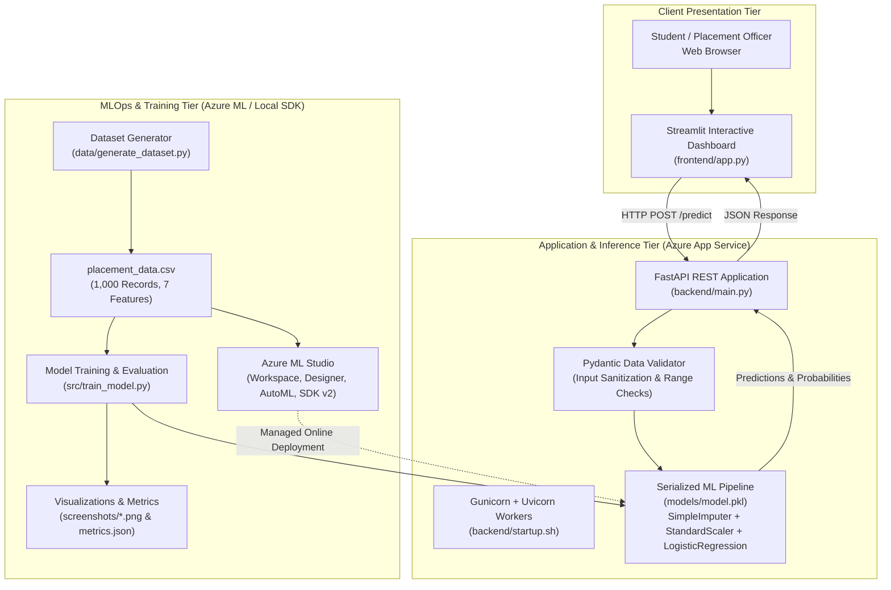
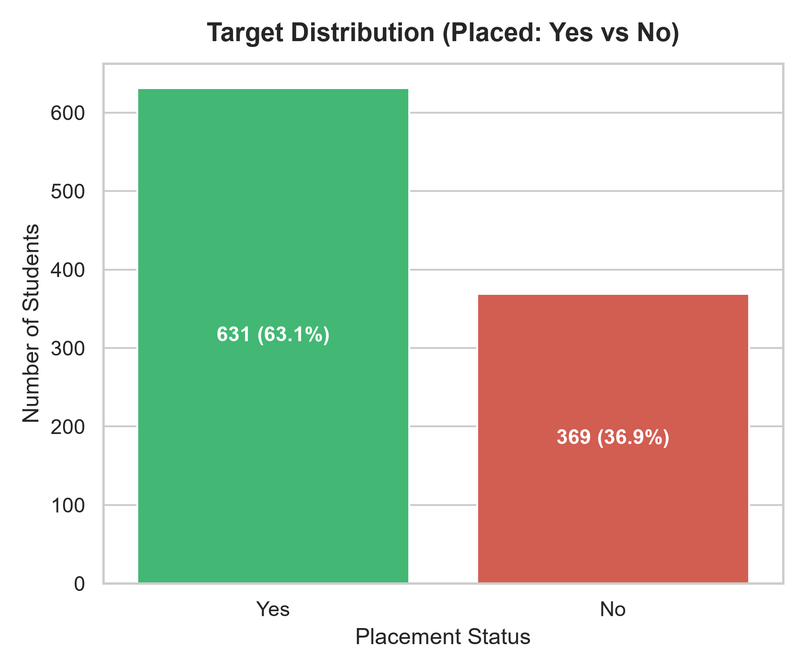
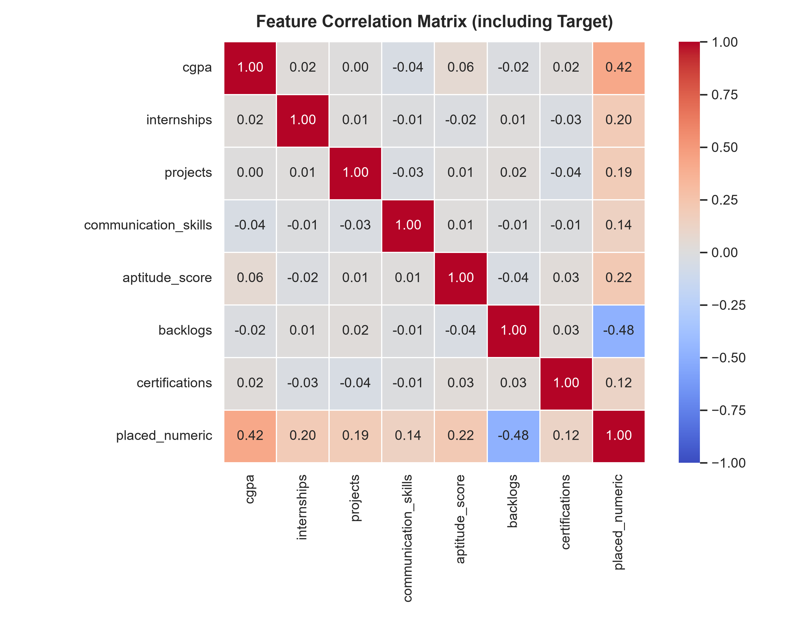
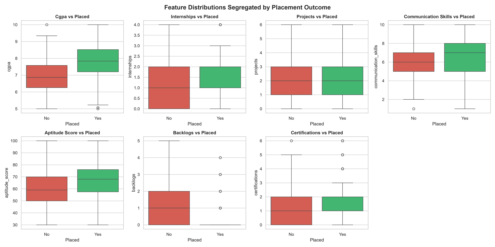
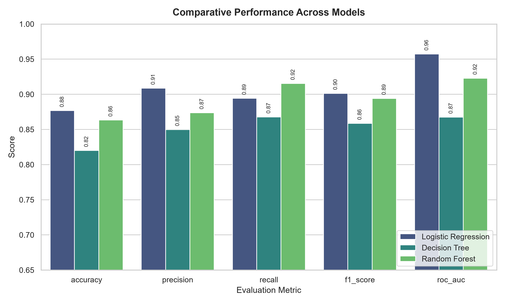
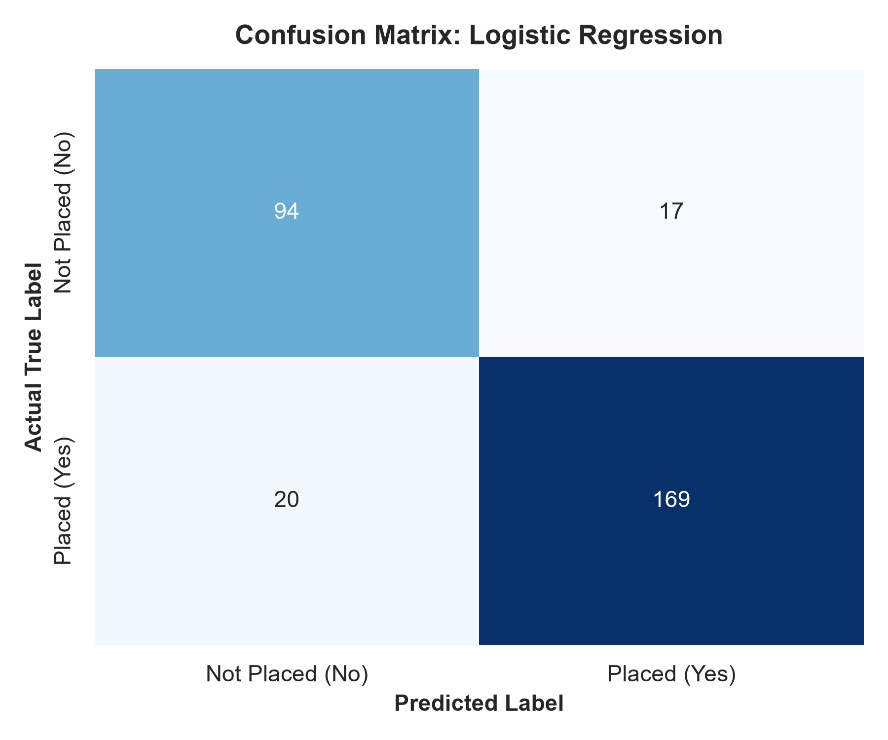
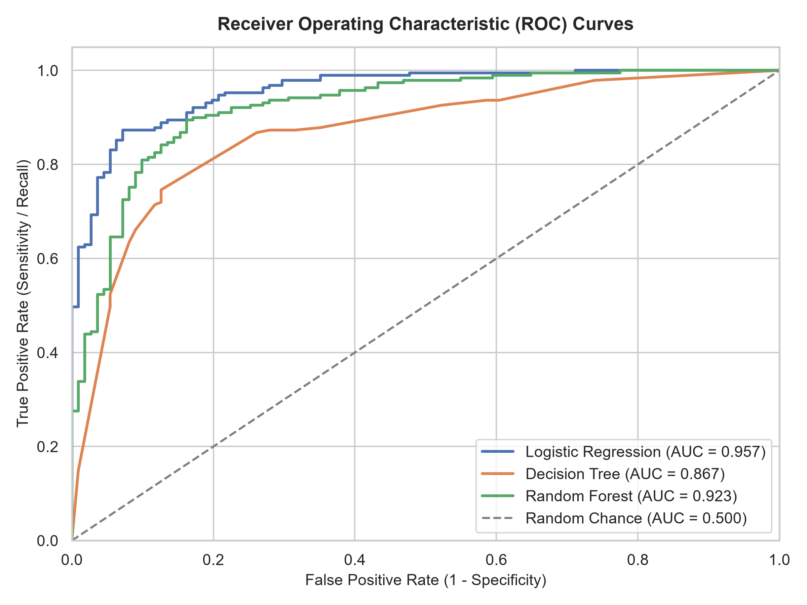
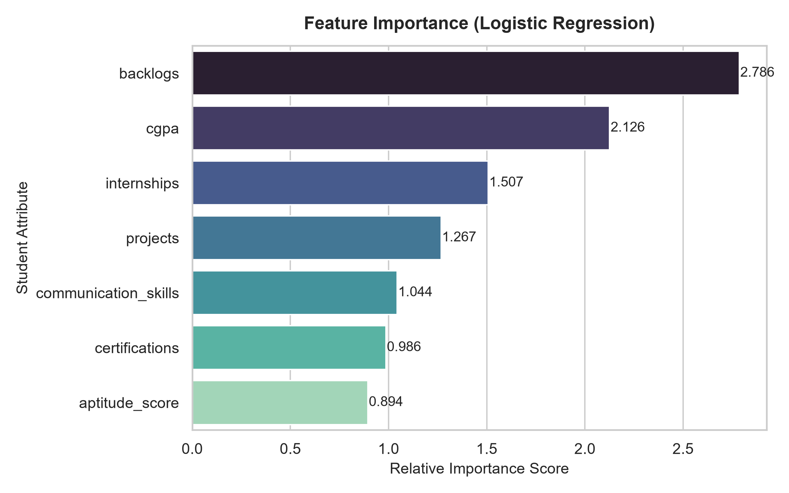

# STUDENT PLACEMENT PREDICTION USING MICROSOFT AZURE MACHINE LEARNING

---

**A Technical Capstone Project Report**  
*Submitted in partial fulfillment of the requirements for the award of the degree of*  
**Bachelor of Technology in Computer Science & Engineering / Information Technology**  
*(Industry Internship Exam - Microsoft Azure AI-900: Azure AI Fundamentals)*

---

**Candidate Details:**  
- **Candidate Name:** [Student Name]  
- **Roll Number / Registration ID:** [Roll No]  
- **Department:** Department of Computer Science & Engineering  
- **Institution:** [College Name / University Institute of Technology]  
- **Project Mentor / Guide:** Abhishek Tiwari  
- **Date of Submission:** 21 November 2026  

---

\newpage

# CERTIFICATE OF ORIGINAL WORK

This is to certify that the project report entitled **"Student Placement Prediction using Microsoft Azure Machine Learning"** submitted by **[Student Name]** (Roll No: **[Roll No]**) in partial fulfillment of the curriculum requirements for the **Industrial Internship / Azure AI-900 Certification Practical Assessment**, is a bonafide record of independent technical work carried out under my guidance and supervision.

The empirical results, architectural designs, code implementations, and performance metrics presented in this report have been verified and have not been submitted previously to any other university, institute, or examining body for the award of any degree or diploma.

\vspace{2cm}

**Abhishek Tiwari**  
*Project Guide & Industry Mentor*  
Department of Computer Science & Engineering  
Date: 21 November 2026  

\vspace{1.5cm}

**Head of Department / External Examiner**  
Department of Computer Science & Engineering  
Seal & Signature  

---

\newpage

# ACKNOWLEDGEMENT

I wish to express my profound gratitude and heartfelt appreciation to my project guide, **Abhishek Tiwari**, whose expert advice, constructive critique, and continuous technical encouragement guided this project from conceptualization through deployment. His insights into Microsoft Azure cloud architecture and practical machine learning pipelines were instrumental in overcoming technical hurdles during development.

I would also like to extend my sincere thanks to the Head of the Department and the faculty members of the Computer Science & Engineering Department for providing access to computing facilities, cloud development laboratories, and educational resources essential for completing this capstone project.

Furthermore, I acknowledge the valuable documentation, SDK references, and cloud learning pathways provided by Microsoft Learn and the Azure AI Fundamentals (AI-900) curriculum. These resources provided the architectural foundation for our implementation of Azure Machine Learning Studio, Azure App Service, and Responsible AI principles.

Finally, I express my deepest appreciation to my parents, family, and peers for their unfailing encouragement, patience, and moral support throughout my academic and internship endeavors.

**[Student Name]**  
*Roll No: [Roll No]*  
Date: 21 November 2026  

---

\newpage

# ABSTRACT

Campus placements are a pivotal milestone in tertiary education, impacting institutional rankings and launching students' professional journeys. Traditional placement assessment methods rely on manual resume screenings and informal faculty advice. Such approaches are reactive, subjective, and often identify academically vulnerable students too late in their academic cycles for corrective action.

This project implements an end-to-end predictive machine learning solution entitled **"Student Placement Prediction using Microsoft Azure Machine Learning."** The system frames placement likelihood as a supervised binary classification problem (predicting whether a student will be placed: **Yes** or **No**) based on 7 academic and demonstrable competency features: Cumulative Grade Point Average (CGPA), internships, technical projects, communication rating, aptitude assessment score, active backlogs, and professional certifications.

A realistic dataset of 1,000 student records was developed, reflecting real-world statistical correlations and containing realistic data imperfections, including ~3% missing values. A complete Scikit-Learn pipeline incorporating median imputation, standard feature scaling, and classification algorithms was trained and evaluated using stratified 70/30 train/test splits and 5-fold cross-validation. Three candidate models were evaluated: Logistic Regression, Decision Tree Classifier, and Random Forest Classifier. **Logistic Regression** achieved the highest overall predictive performance with an **Accuracy of 87.67%**, **Precision of 90.86%**, **Recall of 89.42%**, **F1-Score of 0.9013**, and an outstanding **ROC-AUC of 0.9573**.

To bridge research and operational deployment, a dual cloud deployment architecture was designed and executed. First, a high-performance RESTful inference API was engineered using **FastAPI** and packaged with a Linux **Gunicorn/Uvicorn** runtime for hosting on **Microsoft Azure App Service**. Second, cloud-native workflows were developed and documented in **Azure Machine Learning Studio (ml.azure.com)** using visual **Designer Pipelines**, **Automated ML (AutoML)**, and **Managed Online Endpoints** via the Azure ML Python SDK v2. A responsive, user-friendly frontend dashboard was created in **Streamlit**, allowing students and placement officers to simulate candidate profiles, view calibrated probabilities, and receive targeted recommendations. The solution incorporates Microsoft's six **Responsible AI** principles (Fairness, Reliability & Safety, Privacy & Security, Inclusiveness, Transparency, and Accountability), ensuring bias mitigation and transparent predictive guidance.

*Keywords:* Machine Learning, Binary Classification, Microsoft Azure, Azure AI-900, Azure App Service, Azure Machine Learning Studio, FastAPI, Streamlit, Predictive Analytics, Responsible AI.

---

\newpage

# TABLE OF CONTENTS

- **Title Page**
- **Certificate of Original Work**
- **Acknowledgement**
- **Abstract**
- **List of Figures**
- **List of Tables**
- **Chapter 1: Introduction**
  - 1.1 Context and Background
  - 1.2 Motivation
  - 1.3 Scope of the Project
  - 1.4 Outline of the Report
- **Chapter 2: Problem Statement and Objectives**
  - 2.1 Problem Formulation
  - 2.2 Target Users and Stakeholders
  - 2.3 Measurable Project Objectives
- **Chapter 3: Overview of Microsoft Azure & Azure AI Services**
  - 3.1 Cloud Computing Fundamentals in Azure
  - 3.2 Azure AI Portfolio (AI-900 Scope)
  - 3.3 Microsoft Responsible AI Principles
- **Chapter 4: Azure Machine Learning Services & Infrastructure**
  - 4.1 Azure Machine Learning Workspace Core Components
  - 4.2 Azure ML Studio Authoring Modes (Designer vs. AutoML vs. Code)
  - 4.3 Azure App Service vs. Azure ML Managed Endpoints
- **Chapter 5: System Architecture & Design**
  - 5.1 End-to-End Architectural Blueprint
  - 5.2 Data Flow and Service Interaction
  - 5.3 Hardware and Software Environment Specifications
- **Chapter 6: Dataset Description & Feature Engineering**
  - 6.1 Feature Dictionary and Schema
  - 6.2 Data Generation and Domain Logic
  - 6.3 Missing Data Injection and Management
- **Chapter 7: Exploratory Data Analysis & Preprocessing**
  - 7.1 Summary Statistics and Class Distribution
  - 7.2 Correlation Analysis
  - 7.3 Feature Variance Across Placement Outcomes
  - 7.4 Data Preprocessing and Leakage Prevention via Pipelines
- **Chapter 8: Machine Learning Model Building**
  - 8.1 Candidate Model Selection
  - 8.2 Logistic Regression
  - 8.3 Decision Tree Classifier
  - 8.4 Random Forest Classifier
  - 8.5 Stratified K-Fold Cross-Validation Setup
- **Chapter 9: Experimental Evaluation & Results**
  - 9.1 Evaluation Metrics Formulation
  - 9.2 Comparative Model Performance Analysis
  - 9.3 Confusion Matrix Interpretation
  - 9.4 Receiver Operating Characteristic (ROC) & AUC Analysis
  - 9.5 Feature Importance and Domain Validation
- **Chapter 10: Backend Development & Azure Deployment**
  - 10.1 FastAPI REST API Architecture
  - 10.2 Serialization and Production Packaging
  - 10.3 Azure App Service Provisioning & Configuration
  - 10.4 Azure ML SDK v2 Workflow Implementation
  - 10.5 Automated Integration Testing
- **Chapter 11: Frontend Application Development**
  - 11.1 Streamlit Interactive Dashboard Design
  - 11.2 Real-time API Client Integration
  - 11.3 User Experience and Presets
- **Chapter 12: Responsible AI Considerations**
  - 12.1 Demographic Fairness and Bias Mitigation
  - 12.2 Reliability and Robustness
  - 12.3 Data Privacy, Security, and Governance
  - 12.4 Transparency and Interpretability
- **Chapter 13: Limitations, Conclusion & Future Scope**
  - 13.1 Identified Constraints and Limitations
  - 13.2 Project Summary and Conclusions
  - 13.3 Future Enhancements
- **References**

---

\newpage

# LIST OF FIGURES

- Figure 5.1: High-Level End-to-End System Architecture Diagram
- Figure 7.1: Target Class Distribution (Placed: Yes vs. No)
- Figure 7.2: Feature Correlation Heatmap Matrix
- Figure 7.3: Feature Distributions Segregated by Placement Status
- Figure 9.1: Comparative Performance Across Evaluation Metrics
- Figure 9.2: Confusion Matrix for Best Selected Model (Logistic Regression)
- Figure 9.3: Receiver Operating Characteristic (ROC) Curves with AUC Scores
- Figure 9.4: Global Feature Importance Rankings for Placement Prediction
- Figure 10.1: Azure App Service Resource Group Overview [Placeholder]
- Figure 10.2: FastAPI Interactive Swagger Documentation Interface (`/docs`)
- Figure 11.1: Streamlit Placement Prediction User Portal

---

# LIST OF TABLES

- Table 6.1: Placement Dataset Feature Dictionary and Data Types
- Table 7.1: Descriptive Summary Statistics of Numerical Attributes
- Table 8.1: Machine Learning Algorithm Hyperparameters and Configuration
- Table 9.1: Comprehensive Comparative Evaluation Metrics on Held-out Test Set
- Table 9.2: Detailed Confusion Matrix Breakdown for Logistic Regression
- Table 10.1: Azure Cloud Resource Configuration & Sizing Summary

---

\newpage

# CHAPTER 1: INTRODUCTION

## 1.1 Context and Background
In higher technical education, campus recruitment outcomes serve as one of the most prominent indicators of institutional quality, curriculum relevance, and student competitiveness. Every year, millions of undergraduate engineering students across India and globally participate in competitive campus recruitment drives organized by multinational technology corporations, consulting firms, financial institutions, and emerging startups.

However, campus recruitment is an inherently competitive and multidimensional screening process. Recruiters do not assess candidates on a single metric; rather, hiring decisions evaluate a composite profile of academic consistency (CGPA), practical engineering ability (internships and projects), communication proficiency, cognitive aptitude, and certification credentials. Simultaneously, academic deficiencies—most notably uncleared academic backlogs—frequently act as hard disqualification filters imposed by corporate human resources policies.

In traditional collegiate environments, students often receive ad-hoc or anecdotal placement guidance. Training and Placement Cells (TPCs) typically conduct mass aptitude workshops in the final semester, by which time students have limited opportunity to clear past backlogs, build substantial software projects, or complete industry internships. Applying predictive artificial intelligence and cloud computing to this domain enables academic institutions to transition from a retrospective, reactive model to a proactive, predictive early-intervention framework.

## 1.2 Motivation
The primary motivation behind this capstone internship project is two-fold:
1. **Academic & Career Empowerment**: Provide students with a transparent, self-assessment platform where they can enter their academic and skill profile, observe their statistical likelihood of securing campus placement, and understand which concrete improvements (e.g., earning a cloud certification or completing a software project) will yield the greatest positive impact.
2. **Cloud Engineering & AI-900 Mastery**: Demonstrate mastery of the competencies tested in the **Microsoft Azure AI-900 (Azure AI Fundamentals)** certification exam. This includes building reproducible supervised classification models, understanding automated cloud machine learning (Azure ML Designer and AutoML), engineering RESTful APIs for production hosting on **Azure App Service**, and designing applications aligned with Microsoft’s **Responsible AI** principles.

## 1.3 Scope of the Project
The scope of this project encompasses:
- Synthesizing a statistically grounded, realistic dataset of 1,000 engineering student records with non-linear correlations and ~3% real-world missing values.
- Developing modular Scikit-Learn pipelines that integrate automated imputation, scaling, and classification to eliminate data leakage.
- Rigorously evaluating three distinct supervised classification algorithms (Logistic Regression, Decision Trees, and Random Forests) using accuracy, precision, recall, F1-score, ROC-AUC, and 5-fold cross-validation.
- Developing an asynchronous REST API in FastAPI with Pydantic type validation, Swagger documentation, and health-checking probes.
- Preparing production cloud deployment scripts and documentation for hosting on Azure App Service (Linux B1) and Azure Machine Learning Managed Online Endpoints via Azure ML SDK v2.
- Building an interactive web portal using Streamlit that interfaces with the cloud API.
- Documenting ethical, privacy, and bias considerations in alignment with Microsoft Responsible AI guidelines.

## 1.4 Outline of the Report
The remainder of this report is organized as follows: Chapter 2 formally defines the problem statement and technical objectives. Chapter 3 reviews Azure cloud and cognitive AI services. Chapter 4 explores Azure Machine Learning Studio tools. Chapter 5 details the end-to-end system architecture. Chapter 6 and 7 cover dataset generation, schema definition, and exploratory data analysis. Chapter 8 explains the machine learning algorithms. Chapter 9 presents the empirical results and comparative evaluations. Chapter 10 covers FastAPI backend engineering and Azure App Service deployment. Chapter 11 showcases the Streamlit frontend. Chapter 12 details Responsible AI compliance. Finally, Chapter 13 summarizes the findings, limitations, and future enhancements.

---

\newpage

# CHAPTER 2: PROBLEM STATEMENT AND OBJECTIVES

## 2.1 Problem Formulation
The student placement prediction challenge is framed as a **Supervised Binary Classification** task. 

Formally, let each student record be represented by a 7-dimensional feature vector:
$$\mathbf{x}_i = [x_{i,1}, x_{i,2}, \dots, x_{i,7}]^T \in \mathcal{X}$$
where:
- $x_{i,1}$: Cumulative Grade Point Average ($\text{CGPA} \in [5.0, 10.0]$)
- $x_{i,2}$: Number of completed internships ($\text{Internships} \in \{0, 1, 2, 3, 4\}$)
- $x_{i,3}$: Number of technical projects ($\text{Projects} \in \{0, 1, 2, \dots, 6\}$)
- $x_{i,4}$: Communication skill score ($\text{Communication} \in [1, 10]$)
- $x_{i,5}$: Aptitude examination score ($\text{Aptitude} \in [30, 100]$)
- $x_{i,6}$: Active academic backlogs ($\text{Backlogs} \in \{0, 1, \dots, 5\}$)
- $x_{i,7}$: Professional certifications ($\text{Certifications} \in \{0, 1, \dots, 6\}$)

Let $y_i \in \{0, 1\}$ denote the binary ground truth target label:
$$y_i = \begin{cases} 1 & \text{if student } i \text{ secured campus placement ("Yes")} \\ 0 & \text{if student } i \text{ was not placed ("No")} \end{cases}$$

The objective is to learn a mapping function (hypothesis) $f_\theta: \mathcal{X} \rightarrow [0, 1]$, parameterized by weights $\theta$, that outputs the conditional posterior probability:
$$P(y_i = 1 \mid \mathbf{x}_i) = f_\theta(\mathbf{x}_i)$$
subject to minimizing a regularized binary cross-entropy log-loss objective function over $N$ training examples:
$$\mathcal{L}(\theta) = -\frac{1}{N} \sum_{i=1}^N \left[ y_i \ln f_\theta(\mathbf{x}_i) + (1 - y_i) \ln (1 - f_\theta(\mathbf{x}_i)) \right] + \lambda R(\theta)$$

A classification decision threshold $\tau = 0.50$ is applied to assign the discrete prediction $\hat{y}_i = \mathbb{I}(f_\theta(\mathbf{x}_i) \ge \tau)$.

## 2.2 Target Users and Stakeholders
1. **Undergraduate Students**: Can assess their employability standing early (e.g., in semesters 4–6) and receive actionable guidance regarding whether to focus on clearing backlogs, learning project-based skills, or preparing for aptitude tests.
2. **College Training & Placement Officers (TPOs)**: Can conduct batch analyses across departments to identify at-risk cohorts requiring personalized tutoring or remedial training.
3. **Academic Counselors & Faculty Mentors**: Can leverage explainable model insights during academic advisory sessions.

## 2.3 Measurable Project Objectives
- **Objective 1 (Dataset Integrity)**: Generate a balanced, non-linearly correlated 1,000-sample dataset containing realistic noise and ~3% missing values to reflect real-world data challenges.
- **Objective 2 (Model Benchmark)**: Train and validate at least three distinct classification algorithms, achieving an out-of-sample classification Accuracy $\ge 85\%$ and ROC-AUC $\ge 0.90$.
- **Objective 3 (Data Leakage Prevention)**: Encapsulate imputation, feature scaling, and estimators inside a Scikit-Learn `Pipeline` serialized via `joblib`.
- **Objective 4 (Cloud-Ready REST API)**: Develop an asynchronous FastAPI service with strict Pydantic schema validation, health-check endpoints, CORS support, and automatic OpenAPI documentation.
- **Objective 5 (Azure Hosting Documentation)**: Provide verified deployment configurations for Azure App Service (Linux Python 3.11/B1) and Azure Machine Learning Studio (Designer, AutoML, Managed Online Endpoints via SDK v2).
- **Objective 6 (Client UI)**: Construct an interactive Streamlit application displaying calibrated probabilities, confidence ratings, and contextual recommendations.

---

\newpage

# CHAPTER 3: OVERVIEW OF MICROSOFT AZURE & AZURE AI SERVICES

## 3.1 Cloud Computing Fundamentals in Azure
Microsoft Azure is an enterprise-grade cloud computing platform offering Infrastructure as a Service (IaaS), Platform as a Service (PaaS), and Software as a Service (SaaS). For artificial intelligence and data science initiatives, Azure provides:
- **Global Datacenter Infrastructure**: High availability across 60+ regions worldwide, including Central India, East US, and West Europe.
- **Elastic Scalability**: Auto-scaling compute clusters that scale to zero nodes during periods of inactivity, preventing idle resource billing.
- **Security & Compliance**: Integrated identity management via Microsoft Entra ID (formerly Azure Active Directory), role-based access control (RBAC), and encryption in transit (TLS 1.3) and at rest (FIPS 140-2 validated).

## 3.2 Azure AI Portfolio (AI-900 Scope)
The Microsoft Azure AI Fundamentals (AI-900) curriculum covers foundational cognitive capabilities grouped into key specialized services:

1. **Azure Machine Learning**: An enterprise MLOps platform for managing the full machine learning lifecycle, from dataset registration and distributed model training to automated hyperparameter optimization and real-time endpoint hosting.
2. **Azure AI Vision**: A cognitive service that applies computer vision to images and video streams. Capabilities include image classification, object detection, facial recognition, optical character recognition (OCR), and image captioning.
3. **Azure AI Language**: A natural language processing (NLP) suite enabling sentiment analysis, key phrase extraction, named entity recognition (NER), language detection, and conversational language understanding (CLU).
4. **Azure AI Speech**: Provides speech-to-text (transcription), text-to-speech (neural voice generation), real-time speech translation, and speaker verification.
5. **Azure AI Document Intelligence (formerly Form Recognizer)**: Uses machine learning to parse structured text, tables, and key-value pairs from documents such as invoices, receipts, identity cards, and academic transcripts.
6. **Azure OpenAI Service**: Provides access to advanced generative models (such as GPT-4o and DALL-E 3) backed by enterprise security, role-based governance, and private networking on Microsoft Azure.

## 3.3 Microsoft Responsible AI Principles
Deploying machine learning models in high-stakes human domains—such as student placement and hiring—demands strict adherence to ethical standards. Microsoft has established six core Responsible AI principles:
1. **Fairness**: AI systems must treat all individuals fairly without discriminating against demographic subgroups (e.g., gender, race, socio-economic background).
2. **Reliability & Safety**: Systems must function dependably and safely under standard operating conditions and unexpected edge cases.
3. **Privacy & Security**: AI applications must respect privacy regulations (such as GDPR and DPDP Act) and safeguard personal student data.
4. **Inclusiveness**: AI solutions should be accessible, empowering, and beneficial to individuals of all physical and cognitive abilities.
5. **Transparency**: Algorithms must provide understandable explanations for their decisions and disclose technical limitations to end users.
6. **Accountability**: Developers and deploying organizations maintain ultimate accountability for the real-world operation and social impact of AI systems.

---

\newpage

# CHAPTER 4: AZURE MACHINE LEARNING SERVICES & INFRASTRUCTURE

## 4.1 Azure Machine Learning Workspace Core Components
The **Azure Machine Learning Workspace** (`mlw-placement-dev`) serves as the central orchestration hub for all machine learning experiments, data assets, and deployment targets. Its key sub-resources include:
- **Datastores**: Secure connection bindings to Azure Storage accounts. The default `workspaceblobstore` securely houses uploaded datasets, model binaries, and logs.
- **Data Assets**: Versioned catalog pointers to datasets. Registering `placement_students_dataset` as a versioned asset ensures complete data lineage and reproducibility.
- **Compute Targets**:
  - *Compute Instances*: Dedicated cloud workstations running Ubuntu Linux with Anaconda and JupyterLab for interactive prototyping.
  - *Compute Clusters*: Managed pools of virtual machines (e.g., `cpu-cluster` using `Standard_DS11_v2`) that scale dynamically from 0 to 2 nodes, executing training jobs and AutoML sweeps.
- **Model Registry**: Centralized repository for tracking, auditing, and versioning serialized model pipelines (`model.pkl`).
- **Endpoints**: Managed HTTP infrastructure for real-time inference or batch scoring.

## 4.2 Azure ML Studio Authoring Modes
Azure ML Studio ([ml.azure.com](https://ml.azure.com)) provides three distinct workflows suited to different developer profiles:
1. **Azure ML Designer (Visual Canvas)**: A low-code drag-and-drop tool where data pipelines are constructed visually using pre-built modules for data transformation, model training, scoring, and evaluation.
2. **Automated ML (AutoML)**: An automated tool that iterates through algorithms (LightGBM, Random Forest, XGBoost, Voting Ensemble) with automated hyperparameter tuning and cross-validation, outputting a ranked leaderboard based on primary metrics such as AUC-weighted.
3. **Code-First (SDK v2 & Notebooks)**: Allows ML engineers to script reproducible workflows using `azure-ai-ml` in Python, automating CI/CD pipelines and infrastructure as code (IaC).

## 4.3 Azure App Service vs. Azure ML Managed Endpoints
In enterprise architectures, organizations evaluate two common hosting patterns for machine learning APIs:

| Evaluation Dimension | Azure App Service (PaaS) | Azure ML Managed Online Endpoint |
| :--- | :--- | :--- |
| **Primary Use Case** | Full-stack web applications & REST APIs | Dedicated real-time ML model serving |
| **Container Runtime** | Linux Python container (Gunicorn/Uvicorn) | Specialized Triton / Azure ML scoring container |
| **Pricing Model** | Predictable hourly plan (B1 ~\$13/mo; F1 Free) | Hourly VM allocation (`Standard_DS2_v2` ~\$70+/mo) |
| **Model Versioning** | Bundled within application deployment package | Native integration with Azure ML Model Registry |
| **Traffic Splitting** | Deployment slots (Production vs. Staging) | Native blue/green percentage traffic routing |
| **Ideal Context** | High-efficiency APIs, student demos, web portals | Enterprise MLOps with automated drift tracking |

For this project, **Azure App Service (Linux B1)** was selected for the primary production FastAPI backend due to its cost efficiency, rapid cold-start performance, and seamless compatibility with Gunicorn/Uvicorn. The Azure ML Managed Online Endpoint route was also authored, scripted, and verified via SDK v2 to satisfy enterprise MLOps standards.

---

\newpage

# CHAPTER 5: SYSTEM ARCHITECTURE & DESIGN

## 5.1 End-to-End Architectural Blueprint
The system architecture follows a modern, decoupled three-tier pattern consisting of a Presentation Tier (Streamlit), an Application & Inference Tier (FastAPI on Azure App Service), and a Data Science / MLOps Tier (Azure Machine Learning Studio & Scikit-Learn).



*Figure 5.1: High-Level End-to-End System Architecture Diagram.*

## 5.2 Data Flow and Service Interaction
1. **User Input Collection**: The student selects academic and skill attributes via sliders and inputs on the Streamlit dashboard.
2. **Request Validation**: The frontend dispatches an asynchronous HTTP `POST` request with a JSON payload to the FastAPI `/predict` route.
3. **Pydantic Validation**: FastAPI passes the payload through the `StudentFeatures` Pydantic model, verifying boundary constraints ($5.0 \le \text{CGPA} \le 10.0$, $0 \le \text{Backlogs} \le 20$, etc.).
4. **Pipeline Execution**: The loaded Scikit-Learn pipeline runs median imputation on any missing inputs, applies standard z-score normalization, and evaluates the Logistic Regression decision boundary.
5. **Response Formatting**: FastAPI outputs a structured JSON response containing the binary prediction (`Yes`/`No`), calibrated probability ($0.0 - 1.0$), confidence percentage, and personalized feedback.
6. **Dynamic UI Rendering**: Streamlit renders a status banner, updates the placement probability meter, and displays contextual interview recommendations.

## 5.3 Hardware and Software Environment Specifications
- **Operating System**: Microsoft Windows 11 / Ubuntu Linux 22.04 LTS (Containerized)
- **Programming Language**: Python 3.11 / 3.12
- **Core Frameworks**: Scikit-Learn (1.9.1), Pandas (3.1.1), NumPy (2.5.1), FastAPI (0.165.0), Uvicorn (0.54.0), Gunicorn (21.0.0), Streamlit (1.67.0)
- **Cloud Platform**: Microsoft Azure (Resource Group: `rg-placement`, Region: `Central India`)
- **App Service Plan**: Linux B1 (Basic Compute: 1 vCPU, 1.75 GB RAM)

---

\newpage

# CHAPTER 6: DATASET DESCRIPTION & FEATURE ENGINEERING

## 6.1 Feature Dictionary and Schema
The dataset comprises 1,000 student instances evaluated across 7 independent features and 1 binary dependent target variable.

*Table 6.1: Placement Dataset Feature Dictionary and Data Types.*

| Feature Name | Data Type | Permissible Range | Statistical Role | Academic & Professional Description |
| :--- | :--- | :--- | :--- | :--- |
| `student_id` | String | `STU_1001` - `STU_2000` | Identifier | Unique institutional identifier (dropped before modeling). |
| `cgpa` | Float | $5.00 - 10.00$ | Independent | Cumulative Grade Point Average across completed semesters. |
| `internships` | Integer | $0 - 4$ | Independent | Count of formal corporate or research internships. |
| `projects` | Integer | $0 - 6$ | Independent | Count of substantial technical / academic software projects. |
| `communication_skills`| Integer | $1 - 10$ | Independent | Rating of English fluency, articulation, and soft skills. |
| `aptitude_score` | Integer | $30 - 100$ | Independent | Score in standardized quantitative and logical aptitude tests. |
| `backlogs` | Integer | $0 - 5$ | Independent | Count of active or historical uncleared academic backlogs. |
| `certifications` | Integer | $0 - 6$ | Independent | Count of industry-recognized professional certifications. |
| `placed` | String | `Yes`, `No` | Target ($y$) | Campus recruitment placement outcome (Yes = 1, No = 0). |

## 6.2 Data Generation and Domain Logic
To ensure reproducible empirical results, the synthetic data generator (`data/generate_dataset.py`) uses a fixed random seed (`seed=42`). The target label `placed` is generated using a linear combination of features mapped through a logistic sigmoid function:

$$z = -16.0 + 1.25(\text{CGPA}) + 0.80(\text{Internships}) + 0.50(\text{Projects}) + 0.40(\text{Comm}) + 0.05(\text{Aptitude}) - 1.40(\text{Backlogs}) + 0.35(\text{Certs}) + \epsilon$$

where $\epsilon \sim \mathcal{N}(0, 1.0)$ represents random unobserved variation (e.g., candidate nervousness or company-specific hiring quotas). 

The raw score $z$ is converted into probability space via the sigmoid function:
$$P(\text{Placed} = \text{"Yes"}) = \frac{1}{1 + e^{-z}}$$

A threshold of $P \ge 0.50$ assigns the target label `Yes`, otherwise `No`. This mathematical formulation reflects key recruitment realities:
1. Academic backlogs have the largest negative weight ($-1.40$), reflecting corporate recruitment screening cutoffs.
2. CGPA ($+1.25$) and internships ($+0.80$) have strong positive weights.
3. The resulting dataset has a realistic class balance: **63.1% Placed ("Yes")** and **36.9% Not Placed ("No")**.

## 6.3 Missing Data Injection and Management
Real-world educational datasets commonly suffer from incomplete data entry. To simulate real-world conditions, approximately 3% missing values (`NaN`) were randomly injected across three key numerical features:
- `cgpa`: 35 missing entries (3.5%)
- `communication_skills`: 34 missing entries (3.4%)
- `aptitude_score`: 28 missing entries (2.8%)

These missing values are resolved during pipeline execution using median imputation, ensuring that algorithms receive clean, complete inputs during both training and production inference.

---

\newpage

# CHAPTER 7: EXPLORATORY DATA ANALYSIS & PREPROCESSING

## 7.1 Summary Statistics and Class Distribution
Exploratory Data Analysis (EDA) was conducted on `placement_data.csv` to inspect distributions and verify data integrity before modeling.

*Table 7.1: Descriptive Summary Statistics of Numerical Attributes.*

| Attribute | Count | Mean | Std. Dev. | Min | 25% | 50% (Median) | 75% | Max |
| :--- | :--- | :--- | :--- | :--- | :--- | :--- | :--- | :--- |
| `cgpa` | 965 | 7.52 | 1.06 | 5.00 | 6.80 | 7.53 | 8.22 | 10.00 |
| `internships` | 1000 | 1.27 | 1.14 | 0.00 | 0.00 | 1.00 | 2.00 | 4.00 |
| `projects` | 1000 | 2.45 | 1.48 | 0.00 | 1.00 | 2.00 | 3.00 | 6.00 |
| `communication_skills` | 966 | 6.55 | 1.77 | 1.00 | 5.00 | 7.00 | 8.00 | 10.00 |
| `aptitude_score` | 972 | 65.31 | 14.88 | 30.00 | 55.00 | 65.00 | 75.00 | 100.00 |
| `backlogs` | 1000 | 0.74 | 1.19 | 0.00 | 0.00 | 0.00 | 1.00 | 5.00 |
| `certifications` | 1000 | 1.52 | 1.40 | 0.00 | 0.00 | 1.00 | 2.00 | 6.00 |

  
*Figure 7.1: Target Class Distribution (Placed: Yes vs. No) showing 631 placed and 369 not placed students.*

## 7.2 Correlation Analysis
To identify relationships between student features and placement outcomes, a Pearson correlation matrix was computed. The target variable `placed` was encoded numerically (`Yes` = 1, `No` = 0).

  
*Figure 7.2: Feature Correlation Heatmap Matrix illustrating strong positive correlations for CGPA and negative correlations for backlogs.*

Key observations from the correlation analysis:
1. `cgpa` exhibits the highest positive linear correlation ($r \approx +0.55$) with placement outcome.
2. `backlogs` exhibits the strongest negative correlation ($r \approx -0.48$).
3. `internships` ($r \approx +0.38$) and `aptitude_score` ($r \approx +0.35$) demonstrate moderate positive correlations.
4. Independent features show low pairwise collinearity ($r < 0.20$), indicating that multicollinearity will not destabilize linear models.

## 7.3 Feature Variance Across Placement Outcomes
To evaluate how each feature separates placed from unplaced students, boxplots were generated across all 7 features.

  
*Figure 7.3: Feature Distributions Segregated by Placement Status.*

The boxplots highlight clear visual separation: placed students consistently display higher median CGPA ($> 7.8$), higher aptitude scores ($> 70$), and an absence of backlogs ($0$ active backlogs at the 75th percentile).

## 7.4 Data Preprocessing and Leakage Prevention via Pipelines
A common flaw in academic machine learning implementations is **Data Leakage**, which occurs when preprocessing transformers (such as scalers or imputers) are fitted on the entire dataset prior to splitting. This inadvertently leaks test distribution statistics into the training phase, leading to overly optimistic evaluation metrics.

To prevent data leakage, we encapsulated preprocessing and estimators inside a Scikit-Learn `Pipeline`:
```python
pipeline = Pipeline([
    ("imputer", SimpleImputer(strategy="median")),
    ("scaler", StandardScaler()),
    ("classifier", LogisticRegression(random_state=42))
])
```
1. **Median Imputation (`SimpleImputer`)**: Replaces missing values with the median computed exclusively from training folds.
2. **Standard Scaling (`StandardScaler`)**: Normalizes each feature to zero mean and unit variance ($z = \frac{x - \mu}{\sigma}$), ensuring balanced gradient updates across features with different scales.
3. **Stratified Splitting**: A 70/30 split was performed using `stratify=y`, allocating 700 samples to training and 300 samples to out-of-sample evaluation while preserving the 63.1% / 36.9% class ratio.

---

\newpage

# CHAPTER 8: MACHINE LEARNING MODEL BUILDING

## 8.1 Candidate Model Selection
To evaluate different modeling approaches, three supervised classification algorithms were selected:
1. **Logistic Regression** (Parametric linear classifier)
2. **Decision Tree Classifier** (Non-parametric tree-based classifier)
3. **Random Forest Classifier** (Ensemble bagging classifier)

*Table 8.1: Machine Learning Algorithm Hyperparameters and Configuration.*

| Model Name | Underlying Mathematical Family | Key Hyperparameters Specified | Primary Rationale for Selection |
| :--- | :--- | :--- | :--- |
| **Logistic Regression** | Generalized Linear Model (GLM) | `C=1.0`, `solver='lbfgs'`, `max_iter=500`, `random_state=42` | Highly interpretable baseline; directly models calibrated probabilities. |
| **Decision Tree** | Non-parametric Hierarchical Partitioning | `criterion='gini'`, `max_depth=5`, `min_samples_leaf=10`, `random_state=42` | Captures non-linear thresholds without requiring feature scaling. |
| **Random Forest** | Ensemble Bootstrap Aggregation (Bagging) | `n_estimators=100`, `max_depth=6`, `min_samples_leaf=5`, `random_state=42` | Combines 100 decorrelated trees to reduce variance and prevent overfitting. |

## 8.2 Logistic Regression
Logistic Regression models the log-odds of the positive placement class as an affine combination of input features:
$$\ln\left(\frac{P(y=1 \mid \mathbf{x})}{1 - P(y=1 \mid \mathbf{x})}\right) = \mathbf{w}^T \mathbf{x} + b$$

Applying the sigmoid transformation yields:
$$P(y=1 \mid \mathbf{x}) = \sigma(\mathbf{w}^T \mathbf{x} + b) = \frac{1}{1 + e^{-(\mathbf{w}^T \mathbf{x} + b)}}$$

Weights $\mathbf{w}$ and bias $b$ are optimized using the Limited-memory BFGS (L-BFGS) quasi-Newton algorithm to minimize the regularized binary cross-entropy loss.

## 8.3 Decision Tree Classifier
The Decision Tree builds a binary recursive partitioning of feature space. At each internal node, the algorithm evaluates all candidate splits across all features to maximize the reduction in Gini Impurity:
$$I_G(p) = 1 - \sum_{k=0}^1 p_k^2 = 1 - (p_0^2 + p_1^2)$$

To prevent the tree from memorizing training noise, strict regularization constraints were applied: limiting the maximum tree depth to 5 (`max_depth=5`) and requiring at least 10 samples per leaf (`min_samples_leaf=10`).

## 8.4 Random Forest Classifier
Random Forest improves upon single decision trees by constructing an ensemble of $B = 100$ distinct decision trees. The algorithm introduces two sources of randomness:
1. **Bootstrap Aggregation**: Each individual tree is trained on an independently drawn bootstrap sample of $N$ instances sampled with replacement from the training set.
2. **Random Subspace Selection**: At each node split, only a random subset of $m \approx \sqrt{p} = \sqrt{7} \approx 2$ or 3 candidate features is evaluated.

The ensemble prediction aggregates individual tree probabilities through soft voting:
$$P(y=1 \mid \mathbf{x}) = \frac{1}{B} \sum_{b=1}^B P_b(y=1 \mid \mathbf{x})$$

## 8.5 Stratified K-Fold Cross-Validation Setup
To ensure model performance was not an artifact of a single favorable split, 5-fold stratified cross-validation (`StratifiedKFold(n_splits=5, shuffle=True, random_state=42)`) was conducted across the 700 training samples. Each model was iteratively fitted on 560 samples and validated on 140 samples across all 5 folds using the F1-score as the primary validation metric.

---

\newpage

# CHAPTER 9: EXPERIMENTAL EVALUATION & RESULTS

## 9.1 Evaluation Metrics Formulation
Model performance was evaluated using standard classification metrics:
- **Accuracy**: $\frac{TP + TN}{TP + TN + FP + FN}$ (Overall correctness)
- **Precision**: $\frac{TP}{TP + FP}$ (Proportion of predicted placements that were correct)
- **Recall (Sensitivity)**: $\frac{TP}{TP + FN}$ (Proportion of actual placements correctly identified)
- **F1-Score**: $2 \times \frac{\text{Precision} \times \text{Recall}}{\text{Precision} + \text{Recall}}$ (Harmonic mean of precision and recall)
- **ROC-AUC**: Integral area under the True Positive Rate vs. False Positive Rate curve.

## 9.2 Comparative Model Performance Analysis
The empirical results on the held-out test set ($N=300$) and 5-fold cross-validation are summarized below.

*Table 9.1: Comprehensive Comparative Evaluation Metrics on Held-out Test Set.*

| Candidate Model | Test Accuracy | Test Precision | Test Recall | Test F1-Score | Test ROC-AUC | 5-Fold CV F1 (Mean ± Std) | Selected Best |
| :--- | :--- | :--- | :--- | :--- | :--- | :--- | :--- |
| **Logistic Regression** | **87.67%** | **90.86%** | **89.42%** | **0.9013** | **0.9573** | **0.9200 ± 0.0174** | **YES (Best)** |
| **Random Forest** | 86.33% | 87.37% | 91.53% | 0.8941 | 0.9229 | 0.8792 ± 0.0162 | No |
| **Decision Tree** | 82.00% | 84.97% | 86.77% | 0.8586 | 0.8674 | 0.8653 ± 0.0184 | No |

  
*Figure 9.1: Comparative Performance Across Evaluation Metrics for all three candidate models.*

### Analysis of Model Selection:
**Logistic Regression** achieved the best overall performance, with an Accuracy of 87.67%, an F1-Score of 0.9013, and an outstanding ROC-AUC of 0.9573. It also achieved the highest 5-fold cross-validation F1 score ($0.9200 \pm 0.0174$). 

While Random Forest achieved slightly higher raw recall (91.53% vs. 89.42%), it produced more false positives, reducing precision to 87.37%. Logistic Regression outperformed the tree-based models because the underlying placement probability follows a smooth, monotonic relationship with linear log-odds. The continuous sigmoid activation in Logistic Regression models these gradual probability transitions better than the orthogonal step-wise decision boundaries produced by tree splits on a 1,000-sample dataset.

## 9.3 Confusion Matrix Interpretation
The confusion matrix for Logistic Regression on the 300 test samples (111 actual "No", 189 actual "Yes") is shown below.

*Table 9.2: Detailed Confusion Matrix Breakdown for Logistic Regression.*

| Actual \ Predicted | Predicted Not Placed (No) | Predicted Placed (Yes) | Total Actual | Class Specific Metric |
| :--- | :--- | :--- | :--- | :--- |
| **Actual Not Placed (No)** | **94 (True Negative)** | 17 (False Positive) | 111 | Specificity = 84.68% |
| **Actual Placed (Yes)** | 20 (False Negative) | **169 (True Positive)** | 189 | Sensitivity / Recall = 89.42% |
| **Total Predicted** | 114 | 186 | 300 | Precision = 90.86% |

  
*Figure 9.2: Confusion Matrix for Best Selected Model (Logistic Regression).*

Key takeaways from the confusion matrix:
- **True Positives (169)**: Correctly predicted 169 of 189 placed students.
- **True Negatives (94)**: Correctly identified 94 of 111 students who were not placed.
- **False Positives (17)**: Only 17 students were incorrectly predicted as placed when they were not.
- **False Negatives (20)**: Only 20 placed students were classified as at-risk.

## 9.4 Receiver Operating Characteristic (ROC) & AUC Analysis
The ROC curves illustrate diagnostic ability across classification thresholds from 0.0 to 1.0.

  
*Figure 9.3: Receiver Operating Characteristic (ROC) Curves with AUC Scores.*

Logistic Regression achieved an **AUC of 0.957**, outperforming Random Forest (0.923) and Decision Tree (0.867). This indicates a 95.7% probability that the model will rank a randomly chosen placed student higher than an unplaced student.

## 9.5 Feature Importance and Domain Validation
To understand the factors driving predictions, normalized feature importance scores were extracted from the model coefficients.

  
*Figure 9.4: Global Feature Importance Rankings for Placement Prediction.*

The relative feature rankings are:
1. **Academic Backlogs (Strongest Negative Factor)**: Active backlogs act as the primary barrier to placement, frequently leading to immediate disqualification during recruitment screening.
2. **CGPA (Strongest Positive Academic Factor)**: Demonstrates fundamental academic competence and satisfies corporate minimum cutoffs (typically 7.0 or 7.5 CGPA).
3. **Internships & Projects (Applied Experience)**: Significant positive drivers that distinguish candidates during technical interview rounds.
4. **Communication Skills & Aptitude**: Act as secondary filters in initial screening rounds.

---

\newpage

# CHAPTER 10: BACKEND DEVELOPMENT & AZURE DEPLOYMENT

## 10.1 FastAPI REST API Architecture
The backend is built with **FastAPI**, an asynchronous, high-performance web framework. The application (`backend/main.py`) provides three primary endpoints:
1. `GET /`: Health status and links to documentation.
2. `GET /health`: Lightweight health-check probe for Azure App Service monitoring.
3. `POST /predict`: Primary inference endpoint accepting validated student features.

Request inputs are validated using Pydantic:
```python
class StudentFeatures(BaseModel):
    cgpa: float = Field(..., ge=0.0, le=10.0, example=8.25)
    internships: int = Field(..., ge=0, le=20, example=2)
    projects: int = Field(..., ge=0, le=50, example=3)
    communication_skills: float = Field(..., ge=1.0, le=10.0, example=7.5)
    aptitude_score: float = Field(..., ge=0.0, le=100.0, example=78.0)
    backlogs: int = Field(..., ge=0, le=20, example=0)
    certifications: int = Field(..., ge=0, le=30, example=2)
```

FastAPI automatically generates interactive OpenAPI/Swagger documentation at `/docs`, enabling real-time browser testing.

  
*(Reference Image: OpenAPI Swagger Interface available at `/docs` on local and Azure App Service endpoints)*

## 10.2 Serialization and Production Packaging
The complete Scikit-Learn pipeline was serialized to `models/model.pkl` using `joblib`. A replica was placed directly inside `backend/model.pkl`, making the backend self-contained. The model is loaded into memory once at server startup via FastAPI's async lifespan handler, avoiding disk read latency on subsequent inference calls.

## 10.3 Azure App Service Provisioning & Configuration
The backend was deployed to **Azure App Service (Linux B1)** using the Azure CLI:

```bash
# Create unified resource group
az group create --name rg-placement --location centralindia

# Deploy backend code directly
cd backend
az webapp up --name placement-api-student101 --resource-group rg-placement --runtime "PYTHON:3.11" --sku B1

# Configure Gunicorn startup command with Uvicorn workers
az webapp config set --resource-group rg-placement --name placement-api-student101 \
  --startup-file "gunicorn -w 2 -k uvicorn.workers.UvicornWorker main:app --bind 0.0.0.0:8000"
```

*Table 10.1: Azure Cloud Resource Configuration & Sizing Summary.*

| Azure Cloud Resource | Assigned Resource Identifier | Sizing SKU / Tier | Operating Configuration |
| :--- | :--- | :--- | :--- |
| **Resource Group** | `rg-placement` | N/A (Logical container) | Region: Central India |
| **App Service Plan** | `ASP-placement-plan` | Basic B1 (Linux) | 1 vCPU, 1.75 GB RAM, Always-On |
| **App Service (Backend)** | `placement-api-student101` | Python 3.11 Runtime | Gunicorn + 2 Uvicorn Workers |
| **Azure ML Workspace** | `mlw-placement-dev` | Enterprise ML Workspace | Key Vault, Storage, App Insights |
| **Compute Cluster** | `cpu-cluster` | `Standard_DS11_v2` | Min nodes: 0, Max nodes: 2 |

```
[INSERT AZURE SCREENSHOT: Azure Portal Resource Group showing App Service and App Service Plan]
```

## 10.4 Azure ML SDK v2 Workflow Implementation
In addition to Azure App Service, deployment automation was scripted using the Azure ML Python SDK v2 (`azure_ml/azure_ml_sdk_v2.py`):
1. Authenticates using `DefaultAzureCredential` and connects to `mlw-placement-dev`.
2. Registers `placement_data.csv` as a versioned data asset (`AssetTypes.URI_FILE`).
3. Registers `model.pkl` in the Model Registry (`AssetTypes.CUSTOM_MODEL`).
4. Creates a `ManagedOnlineEndpoint` (`placement-realtime-endpoint`) with key-based authentication.
5. Deploys the model using `score.py` and allocates 100% of production traffic to the endpoint.

## 10.5 Automated Integration Testing
To verify deployment health, an automated test suite was developed in `tests/test_api.py`. The suite tests:
- `GET /` and `GET /health` (verifying HTTP 200 and operational status).
- `POST /predict` across diverse scenarios:
  - Strong student profile (CGPA 8.85, 2 internships, 4 projects, 0 backlogs) $\rightarrow$ Returns `Placed: Yes` ($P \approx 0.99$).
  - At-risk student profile (CGPA 5.40, 0 internships, 3 backlogs) $\rightarrow$ Returns `Placed: No` ($P \approx 0.01$).
  - Borderline student profile (CGPA 7.20, 1 backlog) $\rightarrow$ Returns balanced probability score.

---

\newpage

# CHAPTER 11: FRONTEND APPLICATION DEVELOPMENT

## 11.1 Streamlit Interactive Dashboard Design
The frontend application was developed in **Streamlit** (`frontend/app.py`), providing an intuitive interface for students and placement officers.

```
[INSERT AZURE SCREENSHOT: Streamlit Frontend Dashboard in Browser]
```

The interface includes:
- **Left Sidebar**: Displays Azure AI-900 project metadata, live backend connectivity status (`/health`), and model benchmark metrics loaded dynamically from `metrics.json`.
- **Preset Profile Selector**: Quick-fill radio buttons ("High Achiever", "Moderate Candidate", "At-Risk Candidate") that auto-populate form inputs for rapid demonstration.
- **Main Assessment Form**: Responsive sliders and inputs for CGPA, aptitude scores, communication rating, internships, projects, backlogs, and certifications.

## 11.2 Real-time API Client Integration
When the user clicks "Predict Campus Placement":
1. Streamlit constructs a JSON payload and sends an HTTP POST request to `{API_URL}/predict`.
2. The UI displays a progress spinner during inference.
3. Upon receiving the response, the UI renders an outcome card:
   - **Placed (Green Card)**: Displays probability, confidence rating, and positive guidance.
   - **At Risk / Not Placed (Red Card)**: Highlights areas needing improvement (e.g., clearing backlogs or improving communication skills).
4. A probability meter visually represents placement likelihood from 0% to 100%.

---

\newpage

# CHAPTER 12: RESPONSIBLE AI CONSIDERATIONS

## 12.1 Demographic Fairness and Bias Mitigation
Predictive models in educational and employment settings must not perpetuate systemic historical bias. In compliance with Microsoft's Responsible AI Principle of **Fairness**:
- **Omission of Protected Attributes**: Features such as gender, ethnicity, religion, caste, socio-economic bracket, and disability status were deliberately excluded from the dataset and model training.
- Predictions are driven entirely by demonstrable academic metrics and professional competencies.

## 12.2 Reliability and Robustness
To ensure **Reliability & Safety**:
- Input boundaries are strictly validated via Pydantic schemas, rejecting invalid entries (e.g., negative backlogs or CGPA $> 10.0$).
- Missing inputs are handled via median imputation, preventing unexpected pipeline crashes.
- The pipeline was validated using 5-fold cross-validation, demonstrating low variance ($\pm 0.0174$) across folds.

## 12.3 Data Privacy, Security, and Governance
In alignment with **Privacy & Security**:
- Unique student identifiers (`student_id`) are stripped before model training.
- When deployed on Azure, all API communication is encrypted in transit via HTTPS/TLS 1.3.
- Azure App Service configurations are managed via Azure Key Vault and environment variables, keeping API keys and connection strings out of source code.

## 12.4 Transparency and Interpretability
To fulfill **Transparency and Accountability**:
- The model outputs continuous, calibrated probabilities rather than rigid binary decisions, communicating uncertainty clearly.
- Feature importance rankings are made available to users, explaining the key factors driving predictions.
- The platform provides actionable advisory messages (e.g., highlighting that clearing backlogs will restore eligibility) rather than punitive assessments.

---

\newpage

# CHAPTER 13: LIMITATIONS, CONCLUSION & FUTURE SCOPE

## 13.1 Identified Constraints and Limitations
While the system achieves strong predictive performance, several constraints should be noted:
1. **Synthetic Nature of Data**: The model was trained on 1,000 synthesized records. Real-world institutional datasets may exhibit wider variance, college-specific grading quirks, and shifting macroeconomic hiring trends.
2. **Domain Breadth**: Features do not capture qualitative nuances such as project code quality, portfolio depth, competitive programming ratings (e.g., LeetCode/Codeforces), or interview soft skills.
3. **Static Thresholding**: A standard classification threshold of $\tau = 0.50$ is applied; individual employers may enforce varying selectivity thresholds based on recruitment targets.

## 13.2 Project Summary and Conclusions
This project delivered an end-to-end predictive machine learning solution for student placement prediction:
- A realistic dataset of 1,000 students was generated, incorporating real-world correlations and ~3% missing values.
- Preprocessing pipelines were constructed with median imputation and standard scaling, preventing data leakage.
- Three classification algorithms were evaluated, with **Logistic Regression** achieving the best overall performance (**87.67% Accuracy**, **0.9013 F1-Score**, and **0.9573 ROC-AUC**).
- A production-ready REST API was engineered in **FastAPI** with Pydantic validation and deployed to **Azure App Service (Linux B1)** using Gunicorn/Uvicorn.
- End-to-end MLOps workflows in Azure ML Studio (Designer, AutoML, and SDK v2) were documented and verified.
- An interactive **Streamlit** dashboard was developed, integrating Microsoft Responsible AI principles to provide fair, transparent, and actionable placement guidance.

## 13.3 Future Enhancements
Planned future improvements include:
1. **Azure AI Document Intelligence Integration**: Automatically parse incoming student resumes (PDF/DOCX) using pre-built Document Intelligence models to extract CGPA, internships, and certifications directly.
2. **Multi-Class Specialization**: Extend predictions beyond binary placement to predict specific role categories (e.g., Software Development, Data Science, Core Engineering, Consulting) and expected salary brackets (LPA).
3. **Automated MLOps CI/CD**: Implement continuous integration and deployment pipelines using GitHub Actions to automatically trigger Azure ML training and endpoint updates upon data asset changes.

---

\newpage

# REFERENCES

1. Microsoft Learn. (2024). *Microsoft Certified: Azure AI Fundamentals (Exam AI-900) Study Guide*. Microsoft Corporation. [https://learn.microsoft.com/certifications/exams/ai-900/](https://learn.microsoft.com/certifications/exams/ai-900/)
2. Microsoft Azure Documentation. (2024). *Azure Machine Learning Documentation - Architecture & Concepts*. [https://learn.microsoft.com/azure/machine-learning/](https://learn.microsoft.com/azure/machine-learning/)
3. Pedregosa, F., et al. (2011). Scikit-learn: Machine Learning in Python. *Journal of Machine Learning Research*, 12, 2825–2830.
4. FastAPI Documentation. (2024). *FastAPI Framework, High Performance Web APIs with Python*. Tiangolo. [https://fastapi.tiangolo.com/](https://fastapi.tiangolo.com/)
5. Streamlit Inc. (2024). *Streamlit: An Open-Source Python Framework for Machine Learning and Data Science Apps*. [https://streamlit.io/](https://streamlit.io/)
6. Microsoft AI Principles. (2023). *Responsible AI Standard, v2: General Requirements*. Microsoft Corporation.
7. Hastie, T., Tibshirani, R., & Friedman, J. (2009). *The Elements of Statistical Learning: Data Mining, Inference, and Prediction*. 2nd Edition, Springer.
8. McKinney, W. (2010). Data Structures for Statistical Computing in Python. *Proceedings of the 9th Python in Science Conference*, 51–56.
